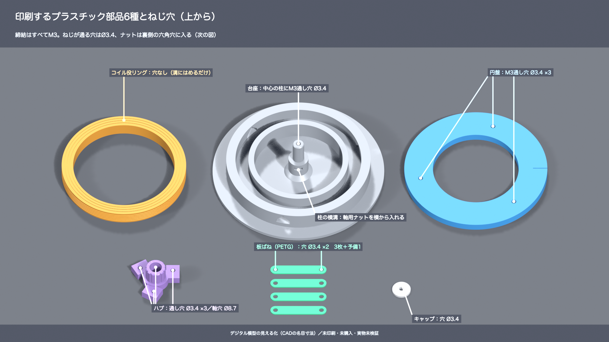

# 電磁ブレーキ学習模型 v2

**磁力のない、手動プラスチック模型です。** 電磁ブレーキの円盤・ハブ・板ばねの関係を学ぶためのCAD、3Dビューア、動画、印刷準備データを収めています。電磁石として作動する実機や高速ロータ用部品ではありません。モーター駆動・通電には使わないでください。

## 印刷ファイルの場所

印刷だけなら**約1.1MBの印刷用ZIP**を取得・展開し、片方の3MFをBambu Studioで開いてください。印刷用STLはリポジトリ内では1か所に保存し、単独取得用ZIPにも同じ6種を収めています。

| ファイル／フォルダー | 中身・個数 | 材料の候補 |
|---|---|---|
| [print-prep/p1s-brake-print-prep.zip](print-prep/p1s-brake-print-prep.zip) | 印刷準備一式。3MF2種、STL6種、手順、配置上面図、確認記録 | 本体PLA／板ばねPETG |
| [print-prep/01-body-PLA-candidate.3mf](print-prep/01-body-PLA-candidate.3mf) | 台座・コイル役リング・ハブ・円盤・キャップを各1個、計5部品 | 本体PLA |
| [print-prep/02-springs-PETG-candidate.3mf](print-prep/02-springs-PETG-candidate.3mf) | 板ばね4枚（使用3枚＋予備1枚） | 板ばねPETG推奨 |
| [model-v2/stl/print/](model-v2/stl/print/) | 元の印刷用STL6種類。ファイル別個数は下表 | 本体PLA／板ばねPETG |
| [print-prep/START-HERE.txt](print-prep/START-HERE.txt) | P1Sで読み込む設定手順と最初の試作確認 | 実際の材料プリセットを選択 |

**3MFは形状と配置のみです。設定入りBambu Studioプロジェクトではなく、プリンター・材料・工程設定もG-codeも含みません。実インポート・実スライス・実印刷は未確認です。** 標準0.4mmノズルを想定していますが、手元のノズル径・材料・ビルドプレートは未確認です。ファイル名は材質設定を確定するものではありません。

配置の上面図は[本体SVG](print-prep/01-body-PLA-candidate.svg)／[板ばねSVG](print-prep/02-springs-PETG-candidate.svg)。これはノズル経路やサポートのスライスプレビューではありません。

### 別PCでダウンロードする

**GitHub Web:** このリポジトリを開き、上の**印刷用ZIPリンク → Download raw file／ダウンロードアイコン → ZIP展開 → `START-HERE.txt` を読む → 片方の3MFをBambu Studioで開く**の順に進みます。サインインなしで取得できます。ファイル単位なら上のリンクから3MFやSTLをダウンロードしてください。全体を取得するなら **Code → Download ZIP** を選び、ZIPを展開します。動画とオフラインビューアにはフォルダー構成が必要なので、全体ZIPが適しています。GitHub上のHTML表示では3Dビューアは動きません。

**Git:** 次のどちらかを実行します。HTTPS cloneは認証不要です。GitHub CLIを使う場合は、CLIの認証手順に従ってください。

```sh
git clone https://github.com/ktanino10/electromagnetic-brake-lab.git
# または、GitHub CLIでログイン済みの場合
gh repo clone ktanino10/electromagnetic-brake-lab
```

取得後、まず `print-prep/START-HERE.txt` を読み、Bambu Studioで片方の3MFを開きます。3MFのみの個別ダウンロードでも使えますが、手順を必ず併せて確認してください。

### STLのファイル別印刷個数

| STL（`model-v2/stl/print/`） | 部品 | 用意する数 |
|---|---|---|
| [01_base_grey.stl](model-v2/stl/print/01_base_grey.stl) | 台座 | 1個 |
| [02_coil_ring_orange.stl](model-v2/stl/print/02_coil_ring_orange.stl) | コイル役リング | 1個 |
| [03_hub_violet.stl](model-v2/stl/print/03_hub_violet.stl) | ハブ | 1個 |
| [04_armature_blue.stl](model-v2/stl/print/04_armature_blue.stl) | 円盤 | 1個 |
| [05_leaf_spring_green_print4.stl](model-v2/stl/print/05_leaf_spring_green_print4.stl) | 板ばね | 4枚（使用3＋予備1） |
| [06_retaining_cap_grey.stl](model-v2/stl/print/06_retaining_cap_grey.stl) | 抜け止めキャップ | 1個 |

`05_leaf_spring_green_print4.stl` は**1枚だけの形状**です。STLから準備する場合は4個複製します。`stl/render/` はCG用で、印刷対象ではありません。

## 模型を見る・組み立て方を調べる

全体をダウンロードして展開し、[model-v2/brake-viewer-v2.html](model-v2/brake-viewer-v2.html) をChromeやEdgeなどWebGL対応ブラウザーで開いてください。外部通信なしで回転・拡大、分解、断面、単独部品、円盤の押下、組立12段階と時間スライダーを操作できます。

| 入口 | 内容 |
|---|---|
| [model-v2/GUIDE.txt](model-v2/GUIDE.txt) | 詳細な組立順、名目寸法、ねじ仕様、限界 |
| [model-v2/blender/stills-holes/](model-v2/blender/stills-holes/) | 通し穴、裏のナット穴、固定部と中心軸の断面、分解図の5枚 |
| [model-v2/cad/brake_teaching_model_v2_screws.FCStd](model-v2/cad/brake_teaching_model_v2_screws.FCStd) | FreeCADネイティブ模型、mm単位 |
| [model-v2/cad/brake_teaching_model_v2_assembly_off.step](model-v2/cad/brake_teaching_model_v2_assembly_off.step) | 組立形状STEP。CADのねじは簡略円柱 |
| [model-v2/blender/brake-teaching-model-v2.blend](model-v2/blender/brake-teaching-model-v2.blend) | Blenderネイティブ組立アニメーション、1 BU = 10 mm |
| [model-v2/blender/brake-model-v2.glb](model-v2/blender/brake-model-v2.glb) | ビューア用形状。印刷用ではありません |



## 動画3本

ローカルで [videos/watch.html](videos/watch.html) を開くと、3本を**初期ミュート・音量0**で再生できます。MP4の直接再生では外部プレーヤーの音量設定が適用されます。

| 実ファイル | 長さ | 内容 |
|---|---|---|
| [model-v2/brake-assembly-v2.mp4](model-v2/brake-assembly-v2.mp4) | 88秒・720p・無音 | 現行v2のねじ組立。[専用プレーヤー](model-v2/watch-assembly.html) |
| [videos/pico-brake-mechanism-explainer.mp4](videos/pico-brake-mechanism-explainer.mp4) | 92秒 | しくみの背景説明。現行v2の印刷・ねじ仕様は上記CAD/STLを参照 |
| [videos/pico-brake-four-angles.mp4](videos/pico-brake-four-angles.mp4) | 40秒 | しくみを4方向から観察する背景CG。現行v2の製作仕様ではありません |

表示する動きは指定した位置・角度・たわみであり、磁場、摩擦、接触、応力を解いた物理シミュレーションではありません。CGのねじ山は外観用、ナットの内ねじは省略しています。

## P1Sの初期設定候補と最初の試作

P1Sの造形領域256×256×256mm、左手前18×28mmの除外領域外、各部品Z=0、mm／100%、部品間の外接矩形すき間5mm以上をデジタル確認しています。既存形状は変更せず、移動配置のみです。ブリム・スカートの広がりや逐次印刷のヘッドクリアランスは含みません。通常の「層ごと」の印刷を使い、本体と板ばねは分けてください。

標準0.4mmノズル、`0.20mm Standard`を初期候補とします。本体は壁3周・インフィル20%、板ばねはPETG・平置き・中実100%を候補にします。厚さ0.8mmの板ばねが、初層0.20mm＋通常層0.20mmで4層になるか実スライスで確認してください。温度とプレートは実際の材料・機器のプリセットを選びます。裏のナット穴の天井のブリッジ、小穴が埋まらないこと、除去不能なサポートが入らないことを確認してから印刷を判断してください。

最初は本体3MFのコピーから**ハブ1個だけ**、板ばね3MFのコピーから**板ばね1枚だけ**を残して試作します。M3ボルト／ナットの入り方、板ばねの小さなたわみと層間剥離を現物で確認し、無理に押し込まず、締め過ぎないでください。嵌合が合わないときに模型全体の倍率を変更しないでください。軸の回転、ナット保持、円盤の戻り、摩擦、耐久性は全体試作後にも確認が必要です。

## ねじBOM（購入・在庫未確認）

| 部品 | 仕様 | 数 |
|---|---|---|
| 六角穴付きボルト | M3×6、ISO 4762相当、並目ピッチ0.5mm | 6本 |
| 六角穴付きボルト | M3×25、ISO 4762相当、並目ピッチ0.5mm | 1本 |
| 六角ナット | M3、ISO 4032相当、二面幅5.5mm・厚さ2.4mm | 7個 |
| 平座金 | M3、ISO 7089相当、内径3.2／外径7／厚さ0.5mm | 7枚 |
| 六角レンチ | 2.5mm | 1本 |

模型の通し穴3.4mm、六角ナット穴AF5.9mm／深さ3.2mm、軸穴8.7mm／柱8.0mmは名目設計値です。M3でも規格によって頭・ナット寸法が異なります。物理的に入ることは未検証です。

## ソースと確認記録

既存の幾何・動画を保持して移設しました。元成果は変更していません。Blenderネイティブは出力先・ファイル選択を相対パス化し、外部フォント参照を内蔵フォントのプレースホルダーへ置換しました。メッシュ・シェイプキー・組立アニメーションは不変です。日本語文字の再レンダリングには手元のフォントを指定してください。旧v1や元資料、第三者フォント・第三者部品図面は収めていません。three.jsのMITライセンスは [THIRD-PARTY-NOTICES.txt](model-v2/web/THIRD-PARTY-NOTICES.txt) に保持しています。

再配置・検証にはPython 3の標準ライブラリーを使います。動画検証にはPATH上のffmpeg／ffprobeが必要です。以下はリポジトリのルートで実行します。再配置スクリプトは形状3MF・上面SVG・確認JSONのみを出力し、単独配布ZIPや元STLを上書きしません。

```sh
python3 print-prep/build_plates.py --source model-v2/stl/print --output print-prep
python3 model-v2/scripts/package_delivery.py
```

ビューアの再ビルドとブラウザー検証はNode.jsとChrome、またはPlaywright Chromiumを使用します。

```sh
cd model-v2/web
npm ci
npm run build
npm test
npm run test:media
```

Chromeを標準位置で検出できない場合は `CHROME_PATH` を指定するか、`npx playwright install chromium` で専用ブラウザーを用意します。CAD再生成はFreeCADのPython環境で `model-v2/scripts/build_v2_cad.py`、CG再生成はBlenderで `model-v2/scripts/build_v2_blender.py` を実行します。日本語CGの再生成には、利用可能な手元の日本語フォントを環境変数 `BRAKE_JAPANESE_FONT` で指定します。フォントファイルは配布しません。Blenderの保存済みシーンも別OSでは手元のフォントへの置換が必要です。

[validation/](validation/) に移設の入力SHA、配置・メッシュ・動画・リンク・ブラウザー確認を保存しています。デジタル確認は印刷成功や物理安全の認証ではありません。**未印刷・未購入・物理未検証・実スライス未確認**です。プリンターへの接続／送信／印刷開始、実機操作、Pages公開は行っていません。
